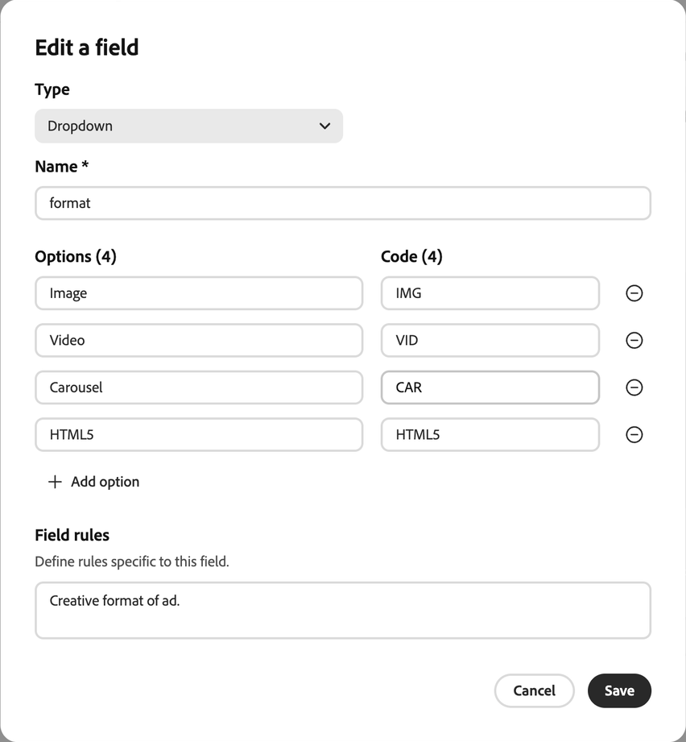
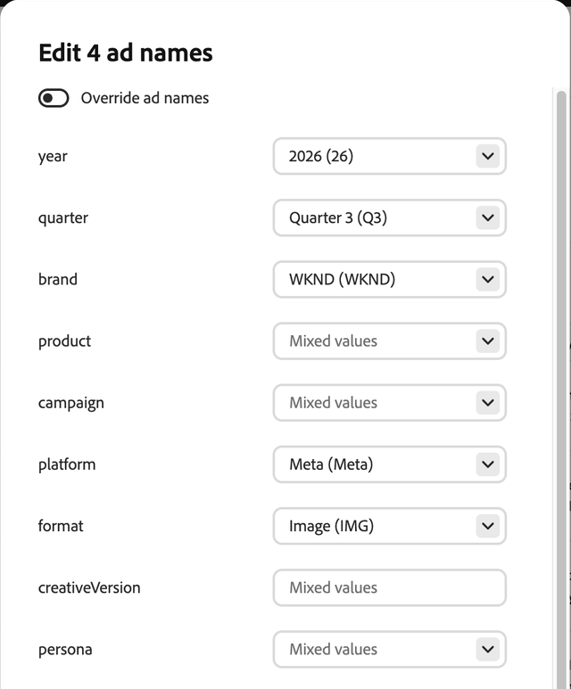

# 生成广告名称

[!DNL GenStudio for Performance Marketing]中的自动广告命名可帮助您在激活广告时遵循组织的命名惯例。 一致的名称支持性能报表、归因和支出对帐。

上载命名约定以创建模板，然后使用它从体验元数据生成名称。 在将广告发送到平台之前，请查看结果并进行任何更正。

## 开始之前

模板设置是一项一次性任务。 如果您的平台在当前项目中已经分配了模板，请跳至[生成激活名称](#generate-names-for-an-activation)。

对于模板设置，请准备一个不超过3 MB的Excel文件，其中只有一个工作表。 不支持CSV文件。 描述单个广告（而非促销活动或广告组）的命名约定。

包括按要求顺序排列的字段、允许的值、相应的代码和用于选择值的说明。 例如，为`format`字段选择`Image`可以在名称中生成`IMG`。

下载[WKND Meta命名惯例示例(Excel)](assets/wknd-meta-naming-convention.xlsx)以探索示例结构。 其中包括年、季度、品牌、产品、促销活动、平台、格式、创意版本、角色、市场、语言和CTA的字段定义和示例值。

在将文件用于您自己的激活之前，请按照您组织的惯例替换示例值和规则。 该示例的平台值说明了命名选择，而不是支持的激活目标列表。

系统管理员必须将模板分配给您的平台。 不同的项目可以为同一平台使用不同的默认模板。

## 创建命名模板

从现有的命名惯例文件创建模板，然后查看提取的结构，然后再使用它。

1. 打开要在其中使用模板的项目。
1. 转到&#x200B;**[!UICONTROL 更多]** > **[!UICONTROL 设置]**。
1. 选择&#x200B;**[!UICONTROL 广告名称模板]**&#x200B;旁边的&#x200B;**[!UICONTROL 设置]**。

   如果模板已存在，请打开&#x200B;**[!UICONTROL 广告名称模板]**，然后选择&#x200B;**[!UICONTROL 创建模板]**。

1. 在&#x200B;**[!UICONTROL 上载文件]**&#x200B;对话框中选择&#x200B;**[!UICONTROL 选择文件]**。
1. 选择您的Excel文件。

   您还可以将文件拖到上传区域。 在出现&#x200B;**[!UICONTROL 分析您的电子表格……]**&#x200B;时，字段和值将映射到您的模板。 这可能需要几分钟的时间。

1. 查看字段、允许的值和&#x200B;**[!UICONTROL 广告名称预览]**。

   预览使用示例值，而不是特定广告的详细信息。

1. 选择&#x200B;**[!UICONTROL 保存]**。

大于3 MB的文件、不支持的文件类型和空文件显示错误而不更改现有模板或平台分配。

## 自定义模板

编辑已保存的模板以调整其名称、字段、分隔符或规则。

1. 转到&#x200B;**[!UICONTROL 更多]** > **[!UICONTROL 设置]** > **[!UICONTROL 广告名称模板]**。
1. 打开模板旁边的三个圆点菜单。
1. 选择&#x200B;**[!UICONTROL 编辑]**。
1. 选择标题旁边的铅笔图标以重命名模板。
1. 设置&#x200B;**[!UICONTROL 字段分隔符]**&#x200B;以匹配您的约定。
1. 将这些字段拖入所需顺序。

   如果需要更改包含哪些字段，请使用&#x200B;**[!UICONTROL 添加字段]**&#x200B;或字段的垃圾桶图标。

1. 选择字段的铅笔图标以打开其设置。
1. 在&#x200B;**[!UICONTROL 编辑字段]**&#x200B;对话框中查看&#x200B;**[!UICONTROL 类型]**&#x200B;和&#x200B;**[!UICONTROL 名称]**。

   对于具有预定义选项的字段，请使用&#x200B;**[!UICONTROL 下拉列表]**；对于您输入的值，请使用&#x200B;**[!UICONTROL 自由文本]**。

1. 对于下拉字段，请查看&#x200B;**[!UICONTROL 选项]**&#x200B;和&#x200B;**[!UICONTROL 代码]**。

   **[!UICONTROL 选项]**&#x200B;包含可读选项。 **[!UICONTROL 代码]**&#x200B;包含广告名称中使用的相应值。 例如，选项`Image`使用代码`IMG`。

   使用&#x200B;**[!UICONTROL 添加选项]**&#x200B;添加选项，或使用选项旁边的减号图标删除选项。 不允许字段中存在重复值。

1. 输入选择或设置该字段值格式所需的任何&#x200B;**[!UICONTROL 字段规则]**。

   对于示例的`creativeVersion`自由文本字段，您可以输入`Use the experience name as a starting value, with spaces removed.`

1. 在字段对话框中选择&#x200B;**[!UICONTROL 保存]**。

   对需要更改的任何其他字段重复该字段查看。

1. 输入适用于该名称的任何&#x200B;**[!UICONTROL 模板规则]**。

   例如，输入`Remove spaces from Product and Campaign values.`

1. 选择页面顶部的&#x200B;**[!UICONTROL 保存]**。

预览反映更新的字段顺序和分隔符。 重新打开模板以检查保存的更改。

字段编辑器显示了可读选项如何映射到已生成名称中包含的代码：

## 将模板分配给平台

系统管理员为项目中的每个平台设置默认模板。 如果您不是系统管理员，请要求一个管理员完成此过程。

1. 打开要设置其平台默认值的项目。
1. 转到&#x200B;**[!UICONTROL 更多]** > **[!UICONTROL 设置]** > **[!UICONTROL 广告名称模板]**。
1. 打开模板旁边的三个圆点菜单。
1. 选择&#x200B;**[!UICONTROL 编辑]**。
1. 在编辑器底部的&#x200B;**[!UICONTROL 首选平台]**&#x200B;下选择一个或多个平台。
1. 选择&#x200B;**[!UICONTROL 保存]**。

每个平台在每个项目中都有一个默认模板。 您可以将同一模板分配给多个平台。

您可以跨项目查看和编辑模板，但只能更改当前所在项目的分配。

替换平台的默认值不会删除以前的模板或更改其他项目的工作分配。

以下示例显示了已选择Meta广告的模板预览、字段顺序、规则和&#x200B;**[!UICONTROL 首选平台]**：

## 为激活生成名称

在准备激活并查看模板所需的体验元数据（如营销活动、产品或角色）后生成名称。

1. 在预期项目中打开&#x200B;**[!UICONTROL 激活]**。
1. 将您的体验添加到激活中。
1. 完成平台设置和所有必需的信息，包括副本、call-to-action (CTA)和网站URL。
1. 检查体验是否具有您的命名惯例所需的元数据。
1. 选择激活表上方的&#x200B;**[!UICONTROL 生成广告名称]**。

   等待&#x200B;**[!UICONTROL 生成广告名称]**&#x200B;完成，然后再查看结果。

1. 查看&#x200B;**[!UICONTROL 广告名称]**&#x200B;列。

层代适用于具有已分配模板的平台上的所有广告，但启用了覆盖的广告除外。 打开表时，不会自动生成名称。

最初，每个广告都使用其体验的名称。 如果平台没有分配模板，层代会保留其名称不变，您可以手动编辑它们。

如果没有为平台分配模板，则不会生成名称。

## 更正单个广告名称

在发送广告之前，请查看生成的名称。 缺少的值显示为高亮显示的字段占位符，如`[market]`，而受影响的广告显示&#x200B;**[!UICONTROL 需要注意]**。

激活表将标记缺少值的名称，以便您查找并更正它们：

1. 在激活表中选择广告的行。
1. 选择&#x200B;**[!UICONTROL 编辑广告名称]**。
1. 更新相关的下拉列表或文本字段。
1. 选择&#x200B;**[!UICONTROL 保存]**。

例如，如果`market`没有值，请输入或选择相应的市场以替换名称中的`[market]`。

根据您的惯例检查更新的名称。

## 解决潜在的重复名称

同一平台上的相同广告名称将被标记为潜在的重复项。

1. 选择其中一个受影响的广告。
1. 选择&#x200B;**[!UICONTROL 编辑广告名称]**。
1. 更改名称，使两个名称不同。
1. 选择&#x200B;**[!UICONTROL 保存]**。

在名称发生更改后，可能会清除重复警告。

## 一次编辑多个广告名称

使用批量编辑可应用共享校正，而不替换每个广告应保持不同的值。

1. 使用行复选框选择广告。
1. 从选择工具栏中选择&#x200B;**[!UICONTROL 编辑广告名称]**。
1. 仅更改在选定广告中应具有相同值的字段。

   **[!UICONTROL 混合值]**&#x200B;表示所选广告当前在字段中有不同的值。 不接触该字段以保留每个广告的值。

1. 选择&#x200B;**[!UICONTROL 保存]**。
1. 查看更新的名称以了解准确性和可能的重复项。

仅更新选定的广告。 未选定的广告保持不变。

对于所选广告中不同的字段，批量编辑器会显示&#x200B;**[!UICONTROL 混合值]**：

例如，仅将角色从`OutdoorBeginners`更改为`Adventurers`会保留不同的产品。 这些简短的名字说明了这种变化：

| 之前 | 之后 |
| --- | --- |
| `WKND_TrailBag_OutdoorBeginners` | `WKND_TrailBag_Adventurers` |
| `WKND_RiosShirt_OutdoorBeginners` | `WKND_RiosShirt_Adventurers` |

## 使用自定义广告名称

当广告需要完整的自定义名称时，覆盖生成的名称。

1. 选择广告的行。
1. 选择&#x200B;**[!UICONTROL 编辑广告名称]**。
1. 打开&#x200B;**[!UICONTROL 覆盖广告名称]**。
1. 输入自定义名称。
1. 选择&#x200B;**[!UICONTROL 保存]**。

再次生成名称时，自定义名称保持不变。

启用覆盖后，您可以编辑完整名称而不是其各个模板字段：

要返回到基于模板的命名，请执行以下步骤：

1. 打开&#x200B;**[!UICONTROL 编辑广告名称]**。
1. 关闭&#x200B;**[!UICONTROL 覆盖广告名称]**。
1. 选择&#x200B;**[!UICONTROL 保存]**。
1. 选择激活表上方的&#x200B;**[!UICONTROL 生成广告名称]**。

此生成操作也适用于表中的其他合格广告。

## 响应模板更改

编辑激活表时，如果使用的模板已更改或删除，则会显示警告。

如果模板已更改，请在重新生成名称之前查看更新的模板。 选择&#x200B;**[!UICONTROL 生成广告名称]**&#x200B;以应用它。

如果模板已被删除或者您需要替换模板，请执行以下步骤：

1. 要求系统管理员将替换模板分配给同一项目中受影响的平台。
1. 返回到激活表。
1. 选择&#x200B;**[!UICONTROL 生成广告名称]**。
1. 查看更新的名称。

启用覆盖的名称在再生期间保持不变。

## 将广告发送到平台

在发送广告之前，请查看最终名称并解决未解决的字段、潜在重复项和其他&#x200B;**[!UICONTROL 需要注意]**&#x200B;问题。

激活就绪后，选择&#x200B;**[!UICONTROL 发送到平台]**。

发布的名称与[!DNL GenStudio for Performance Marketing]中的最终名称完全匹配，包括生成的名称、通过模板字段编辑的名称以及覆盖的名称。

对于显示目标（如Innovid），名称将显示为创意名称。
